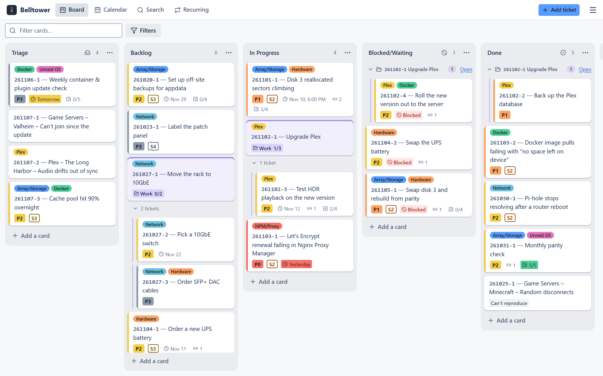

  

<h1 align="center">Belltower</h1>

  <strong>Self-hosted ticketing for homelabs and small teams.</strong> 
  <em>Ring the bell when something breaks.</em>

  
  

  
  
  
  
  

  <a href="https://bernie-sandler.github.io/Belltower/"><strong>Live Demo</strong></a> 
  Try it without installing anything: the demo runs entirely in your browser, and your changes stay there.

---

Belltower is a lightweight ticket tracker for the people who keep things running: whoever runs the home server, the small-office IT person, the friend everyone texts when Plex goes down. It gives you one place to see what's broken, what you're in the middle of, and what's coming up, and to look up how you fixed it last time.

Most tickets are ones you write yourself. A drive starts throwing errors, a container won't update, you've been meaning to move to 10GbE. Make a card for it, drag it across the board as the work moves, and jot down what you tried along the way. When the same thing happens six months later, search finds the card and the note that fixed it.

Tickets can also come from other people through a submit page, or from monitoring tools when something fails, and they land on the same board.

It's built for small setups where a full help desk is overkill and a sticky note isn't enough.

## What it's for

- **Tracking problems:** write down what's wrong, mark how urgent it is, and close it with a note on how it ended
- **Planning bigger jobs:** keep the tickets for something like "Upgrade Plex" together under one work card, and see what's blocking what
- **Staying on top of maintenance:** have a monthly parity check or a quarterly look at SMART data show up as a ticket when it's due
- **Keeping a record:** look back at what changed and when, so you're not relying on memory the next time something acts up

## Features

- **Board view:** a Trello-style board for moving tickets from Triage to Done, with columns you can rename, add, or reorder
- **Detailed tickets:** priority, severity, due dates, checklists (each step done, failed or unverified), attachments, and links between related tickets
- **Labels:** tag tickets by area, like Network, Storage, or Docker
- **History and work log:** every change is recorded automatically, and you can add your own notes, backdated if needed
- **Search and calendar:** search everything, including archived tickets, or see what was due and what got done by month or week
- **Seen this before?:** an open ticket lists similar finished ones and how each was fixed
- **Ring the bell:** a simple page where other people can submit a ticket, without a login or access to your board, and check on it later through a status link
- **Automation:** Uptime Kuma, Unraid, Home Assistant, or your own scripts can open tickets when something fails, and dashboards like Homepage can show ticket counts
- **Notifications:** hear about urgent and blocked tickets, plus a daily summary of what's due, through Discord,
  ntfy, Gotify or any webhook
- **Claude drafting (optional):** with your own Anthropic API key, describe a problem in your own words and review the ticket Claude writes
- **JSON import:** bring in existing tickets in bulk
- **Backups:** nightly snapshots, plus export and restore from the app
- **Phone-friendly:** add it to your Home Screen and it opens full-screen like an app
- **Self-hosted:** runs on your own server, so your data stays with you

<picture>
  <source media="(prefers-color-scheme: dark)" srcset="assets/screenshot-board-dark.png">
  
</picture>

## Status

Belltower is stable. Updates within 1.x never break your data, backups or automation; see
[what 1.0 promises](docs/UPGRADING.md#what-10-promises).

## Quick start (Unraid)

1. Clone this repository somewhere outside your data folder, for example
   `/mnt/user/appdata/belltower-src`.
2. Copy `.env.example` to `.env`. The defaults are fine for most setups.
3. In **Docker → Compose**, add a stack pointing at that folder and press **Compose Up** (or run
   `docker compose up -d`).
4. Open `http://tower:8080`.
5. Grab the one-time setup code from the container log and choose a username and password.

The full walkthrough (where the data should live, every setting) is in
[docs/INSTALL.md](docs/INSTALL.md).

## Documentation

| | |
|---|---|
| [Install and configure](docs/INSTALL.md) | Setting it up on Unraid, `.env` settings, troubleshooting |
| [Upgrading](docs/UPGRADING.md) | Updating, picking a version, rolling back |
| [Using Belltower](docs/USING.md) | A tour of the board, cards, work cards, history, search and settings |
| [Phone and remote access](docs/REMOTE-ACCESS.md) | Tailscale, Nginx Proxy Manager, the Home Screen app |
| [Backups](docs/BACKUP.md) | Snapshots, export and restore, moving to a new server |
| [Submit page](docs/SUBMIT-PAGE.md) | Letting other people file tickets and check on them |
| [Notifications](docs/NOTIFICATIONS.md) | Discord, ntfy, Gotify and webhooks: what gets announced and how to set it up |
| [Automation](docs/AUTOMATION.md) | Uptime Kuma, Unraid, Home Assistant, scripts and dashboards |
| [Claude drafting](docs/AI-DRAFTING.md) | Turning a description into tickets, cost and privacy |
| [Card import format](docs/CARD-IMPORT.md) | Creating cards from JSON (handy with any AI chat) |
| [Automation API (v1)](docs/API-V1.md) | The stable API contract for tools and scripts |
| [Backup file format](docs/BACKUP-FORMAT.md) | What's inside an export |
| [Development](docs/DEVELOPMENT.md) | Building, testing and releasing |
| [Security](SECURITY.md) | What the app protects and what's up to you |
| [Changelog](CHANGELOG.md) | What changed in each version |

## Versions

Tagged releases are published as images at `ghcr.io/bernie-sandler/belltower`. Pick a version with `TT_VERSION` in
`.env`: `latest` for stable releases, or an exact version like `1.2.3`. Updating is
`docker compose pull && docker compose up -d`; the database upgrades itself after saving a copy. See
[docs/UPGRADING.md](docs/UPGRADING.md).
